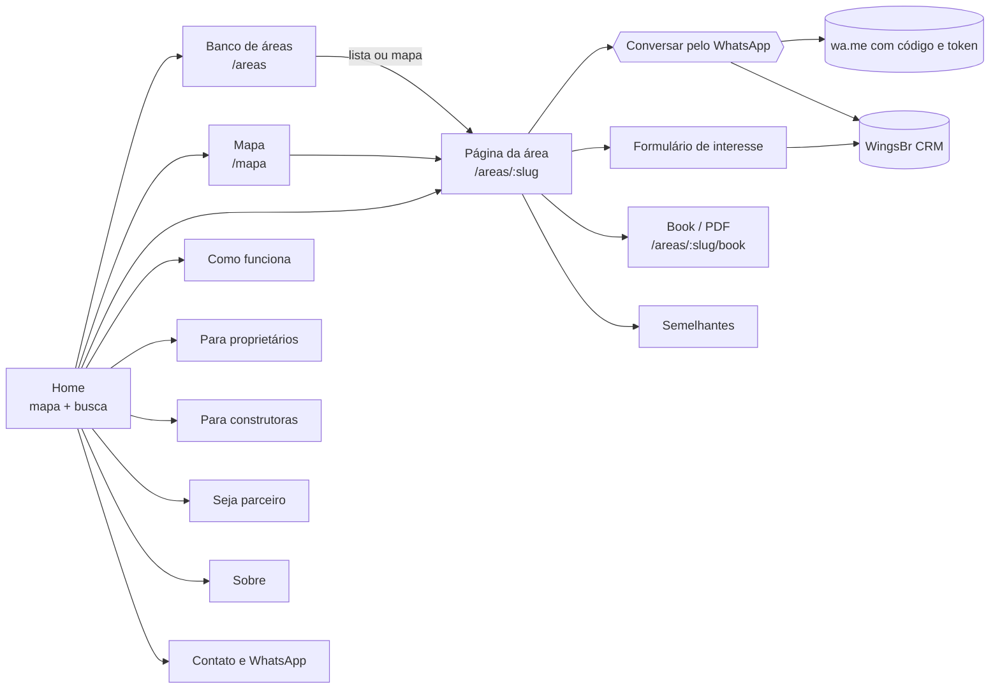

# Mapa de navegação

## Portal público

## Painel (`/painel`) — menu por perfil

| Item | Admin Dourado | Captação | Intermediador | Proprietário | Comprador | Superadmin WingsBr |
|---|---|---|---|---|---|---|
| Visão geral (dashboard) | ✓ | ✓ (sem comissões) | Minha carteira | Minhas áreas | Recomendações | — |
| Banco de áreas / cadastro em 8 etapas | ✓ | ✓ | leitura (atribuídas) | leitura + envio de documentos | — | — |
| Aprovações de publicação | ✓ | — | — | — | — | — |
| Interesses (SLA, transferência, vínculo de mensagens) | ✓ | leitura | atribuídos | — | — | — |
| Negociações (funil arrastável, propostas, comissões) | ✓ | leitura | atribuídas | — | próprias (leitura) | — |
| Captação › Prospecção no mapa (SIGEF, CAR, ONR, Earth) | ✓ | ✓ | ✓ (leitura) | — | — | — |
| Captação › Funil de captação / Minhas indicações | ✓ | ✓ (converte em área) | indicações próprias | — | — | — |
| Compradores e matching | ✓ | ✓ | — | — | perfis próprios | — |
| Atendimento e WhatsApp (regras, intermediadores, número central) | ✓ | — | — | — | — | — |
| Usuários | ✓ | — | — | — | — | ✓ |
| Auditoria | ✓ | — | — | — | — | ✓ |
| Integrações | ✓ (leitura) | — | — | — | — | ✓ |

Etapas do cadastro da área: Identificação → Localização e perímetro → Urbanístico e técnico → Condições comerciais → Proprietários e documentos → Imagens → Responsável e publicação → Compradores compatíveis.
