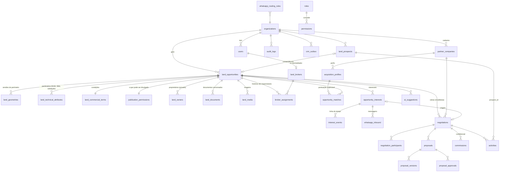

# Modelo entidade-relacionamento

Fonte da verdade: `server/src/db/migrations/001_init.ts`. Todas as tabelas de domínio têm UUID, `created_at` e `updated_at`.

### Captação (migração 002)

| Tabela | Campos principais |
|---|---|
| `land_prospects` | `code` CAP-AAAA-NNNN, `title`, `source`, `stage` (identificada → contato → documentacao → analise → proposta_intermediacao → contratada), `status` (open/converted/discarded), `discard_reason`, `priority`, `land_type`, `uf`, `city`, `lat`/`lng`, `geom` MultiPolygon 4326 (GIST), `area_m2`, `intended_uses[]`, `asking_price_hint`, contato do proprietário + `legal_basis`, `matricula`, `cartorio`, `cns_serventia`, `sigef_code`, `car_code`, `ccir`, `territory_snapshot` jsonb (fonte e data de cada consulta), `checklist` jsonb, `assigned_to`, `referred_by_broker_id`, `next_action(_at)`, `opportunity_id`, `version` |
| `territory_cache` | `key`, `layer`, `data` jsonb, `fetched_at` — respostas WFS por recorte, 24 h |
| `activities.prospect_id` | histórico da prospecção no mesmo modelo de atividades |

## Notas por entidade

| Tabela | Observações |
|---|---|
| `land_opportunities` | `code` único (`DOU-UF-0001`, sequência por organização e UF com *advisory lock*); `slug` estável após publicação; `status` (situação comercial) separado de `publication_status` (draft → pending_review → published/rejected/unpublished); `visibility` public/private; `version` para bloqueio otimista. |
| `land_geometries` | `geometry(MultiPolygon,4326)` com índice GIST; `centroid` (ponto na superfície); `public_point` ofuscado deterministicamente; `area_m2` e `perimeter_m` em geography (elipsoide WGS84); só uma versão `is_current` por área. |
| `land_technical_attributes` | Um registro por parâmetro: `value` (jsonb), `source`, `consulted_at`, `responsible`, `validation_status` (nao_verificado, declarado, verificado, oficial). |
| `land_commercial_terms` | `commission_total_pct` e `commission_split` só são entregues a quem tem `commission.read` no escopo da organização. |
| `publication_permissions` | `show_price`, `show_price_per_m2`, `location_precision` (exact/approximate/region), `show_public_documents`, `legal_basis`, revisão (quem/quando/observação). |
| `land_owners` | `document_enc` em AES-256-GCM; `user_id` liga ao portal do proprietário. |
| `land_documents` | `group_id` + `version` + `is_current`; `confidentiality` (public, internal, confidential, restricted); `sha256`; `valid_until`. |
| `opportunity_interests` | `intent_token` (`DL-XXXXXX`); `status` distingue clique, formulário, conversa iniciada, mensagem recebida; atribuição (UTMs e IDs de clique); base legal; roteamento (regra, número, prazo); sincronização CRM; `ip_hash`. |
| `whatsapp_inbound` | Idempotente por `wa_message_id`; telefone só como hash + máscara; `link_status` linked_token/unlinked/linked_manual. |
| `commissions` | Máquina de estados prevista → contratada → exigível → paga (ou cancelada), `history` em jsonb. |
| `crm_outbox` | Entrega *at-least-once* com `idempotency_key`, `attempts` (máx. 8), backoff exponencial, `SKIP LOCKED`. |
| `crm_contacts` | Espelho **apenas** do modo embutido (sem CRM configurado). Não é usado quando `WINGSBR_CRM_URL` existe. |

## Classificação de dados

| Classe | Onde fica | Quem vê |
|---|---|---|
| Pública | `publicView()` | Todos (ou parceiros logados, se vitrine privada) |
| Interna | `internalView()` | Equipe e intermediador atribuído |
| Confidencial | proprietários, geometria exata, documentos `confidential`, comissões | Administrador; captação (sem comissões) |
| Restrita por negociação | propostas, minutas `restricted` | Participantes da negociação e administrador |

### Importação do inventário (migração 003)

| Tabela | Campos principais |
|---|---|
| `import_runs` | `source`, `origin_label`, `mode` (preview/apply), `summary` (criadas, atualizadas, sem mudança, conflitos, pastas sumidas), `created_by`, datas |
| `import_items` | uma linha por pasta: `external_key` (caminho), `entity_type`/`entity_id` (área ou prospecção), `content_hash`, `sheet_hash`, `imported` (retrato dos valores gravados, para detectar edição manual), `issues`, `status` (active/missing). Único por organização + origem + caminho |
| `import_files` | um registro por arquivo (`sha256`) e destino: document, media, geometry, pending (anexa na conversão da prospecção) ou skipped |

## Login e bases territoriais (migração 004)

- `users`: `password_hash` (scrypt), `mfa_secret_enc` (cifrado), `mfa_recovery_hashes`, `mfa_last_step`, `failed_logins`, `locked_until`, `last_login_at`, `session_version`. E-mail único sem diferenciar maiúsculas.
- `auth_tokens`: convites e redefinições de uso único. Guarda só o hash do token.
- `territory_features`: polígonos das bases oficiais (`layer`, `uf`, `code`, `name`, `area_ha`, `municipio`, `situacao`, `matricula`, `raw`, `geom`).
- `territory_datasets`: o que foi carregado, de qual arquivo e quando.
